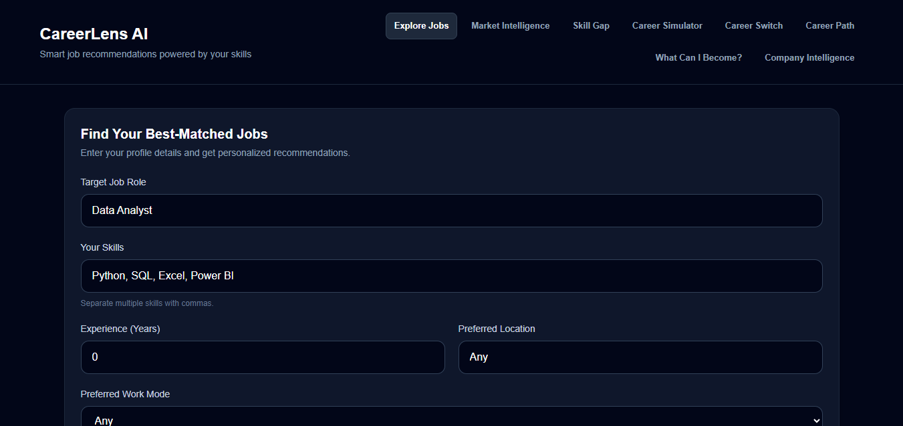
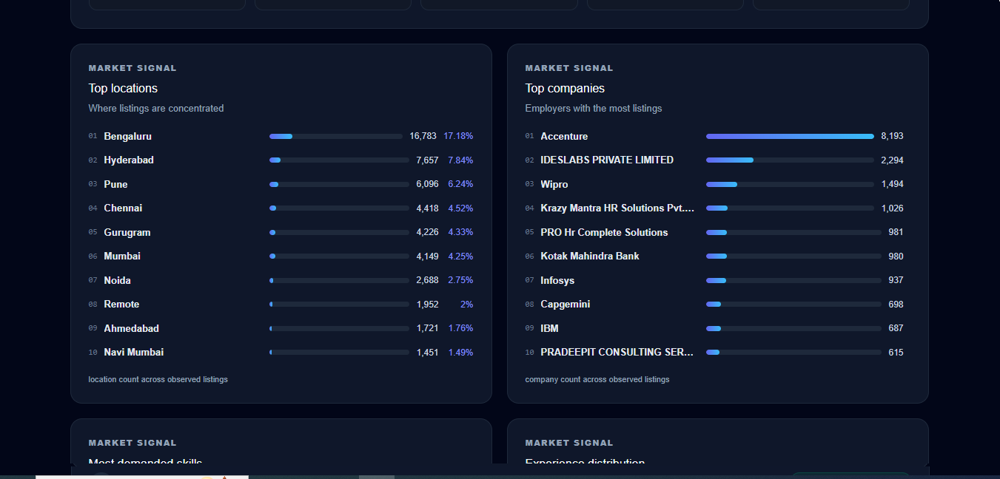

# CareerLens AI - Job Market Intelligence & Career Guidance Platform

CareerLens is a dataset-derived job-market exploration application. It combines job recommendations with market, skill, career, and company analysis so users can inspect the evidence behind each result.

## Problem Statement

Job seekers often need to compare roles, skills, locations, companies, and observed demand in one place. CareerLens makes those comparisons using the current cleaned job dataset rather than unsupported career or hiring claims.

## Key Features

- Job Explorer with role, skill, experience, location, work-mode, and job-type filters
- Market Intelligence for roles, locations, companies, skills, experience, and salary records
- Skill Gap Analyzer
- Career Simulator / What-If analysis
- Career Switch Analyzer
- Career Path Explorer using observed title and skill relationships
- What Can I Become? using dataset job-skill matches
- Company Intelligence using represented company records

## Technology Stack

- Backend: Python, FastAPI, pandas, Pydantic
- Frontend: React, Vite, Tailwind CSS integration, plain CSS
- Data: cleaned job-market records in `data/processed/jobs_cleaned.xlsx`
- Runtime caching: pandas pickle cache with source-file timestamp validation

## Dataset

CareerLens AI requires a cleaned job-market dataset at:

`data/processed/jobs_cleaned.xlsx`

The dataset is not included in this repository. You must obtain the source dataset separately and ensure you have permission to use it. Prepare the cleaned Excel file using the project's data-preparation workflow, then place it at the required path before starting the backend.

The original source dataset and processed data files are excluded from Git to avoid redistributing third-party data without confirming its licence. The application derives job recommendations and market, skill, career, salary, and company insights from the local cleaned dataset.
## Architecture Overview

FastAPI exposes feature endpoints under `backend/main.py`. Services reuse the cached dataframe from `recommendation_service.py`. Startup builds prepared title, skill-match, and company indexes. The React frontend uses state-based navigation in `App.jsx`; React Router is not used.

## Backend Setup

From the repository root, open PowerShell:

```powershell
python -m venv venv
.\venv\Scripts\Activate.ps1
pip install -r requirements.txt
```

## Frontend Setup

```powershell
cd frontend
npm install
```

## Run Locally

**Terminal 1 — Backend** (from the repository root):

```powershell
.\venv\Scripts\Activate.ps1
python -m uvicorn backend.main:app --reload --port 8000
```

**Terminal 2 — Frontend** (from the repository root):

```powershell
cd frontend
npm run dev
```

Open http://localhost:5174 in your browser.

## API Overview

- `POST /recommend`
- `GET /market-intelligence`
- `POST /skill-gap`
- `POST /career-simulator`
- `POST /career-switch`
- `GET /career-path`
- `POST /what-can-i-become`
- `GET /companies`
- `GET /company-intelligence`

## Data Honesty and Limitations

All counts and percentages describe records represented in the current dataset. Skill matches, role relationships, salary values, ratings, and company evidence are descriptive dataset signals. They are not hiring probabilities, employment guarantees, promotion guarantees, company reviews, or complete current company activity.

Salary statistics use only records with available salary data. Ratings and review counts are dataset-listed values and are not independently verified.

## Project Structure

```text
backend/       FastAPI application and feature services
data/          Processed and raw data artifacts
frontend/      React/Vite application
ml/            Machine-learning workspace
notebooks/     Exploration notebooks
powerbi/       BI artifacts
python/        Dataset analysis scripts
sql/           SQL work
screenshots/   Portfolio screenshot destination
```

## Screenshots

## Screenshots

## Screenshots

The following screenshots showcase the main features of CareerLens AI, including job exploration, market insights, skill-gap analysis, career planning, and company intelligence.

### 1. Job Explorer


### 2. Market Intelligence


### 3. Skill Gap Analyzer


### 4. Career Simulator


### 5. Career Switch Analyzer


### 6. Career Path Explorer


### 7. What Can I Become?


### 8. Company Intelligence


## Future Improvements

- Add automated API tests and frontend interaction tests.
- Add a small deployment configuration after the local workflow is stable.
- Improve title-family normalization with reviewed, dataset-specific rules.
- Add deliberate cache/index rebuild observability.


